# GymNastika 2.0.3 — rzeczywiste zrzuty

Zrzuty lokalnej wersji przygotowanej do PR, Chromium, 390px. Wyłącznie syntetyczne profile i treningi. Nie są to testy fizycznego iPhone’a. Każdy widok sprawdzony też przy320/375/430px.

Ekran główny i Ustawienia zaktualizowane po końcowym przeglądzie PR #14: wybór profilu wyłącznie w Ustawieniach. Pozostałe zaakceptowane zrzuty zachowane.

## Ekran główny

| LIGHT | DARK |
|---|---|
| 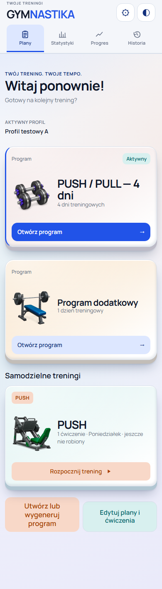 | 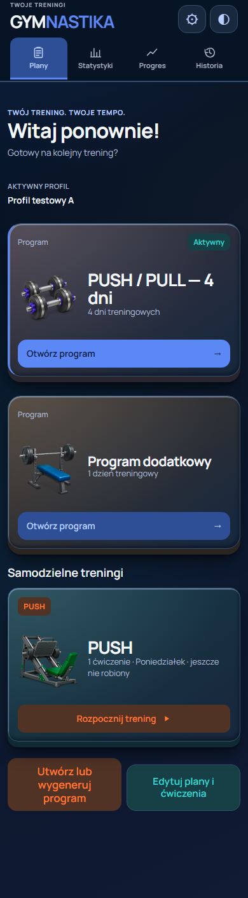 |

## Generator

| LIGHT | DARK |
|---|---|
| 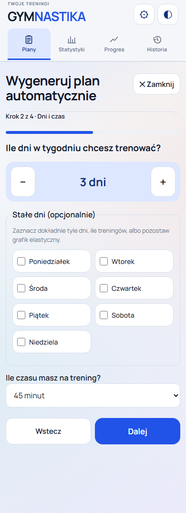 | 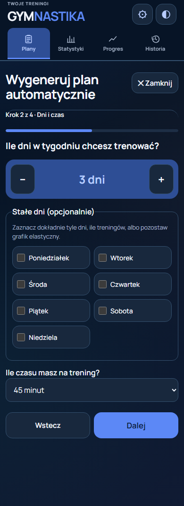 |

## Podgląd propozycji

| LIGHT | DARK |
|---|---|
| 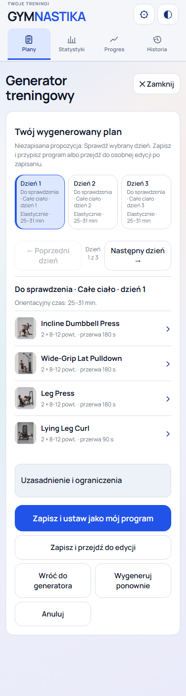 | 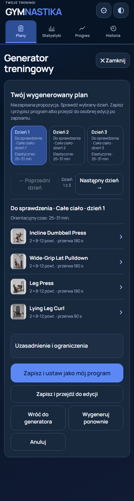 |

## Program

| LIGHT | DARK |
|---|---|
| 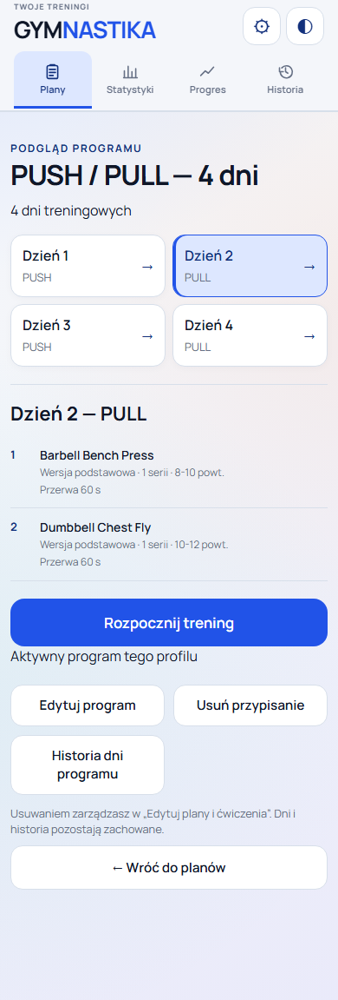 | 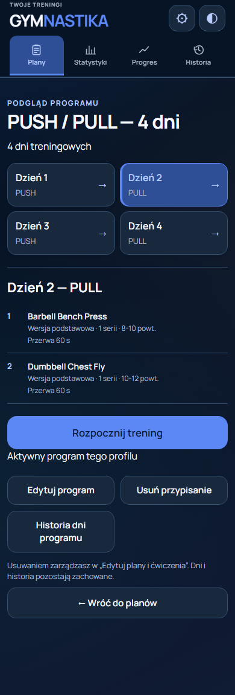 |

## Edytor i zarządzanie

| LIGHT | DARK |
|---|---|
| 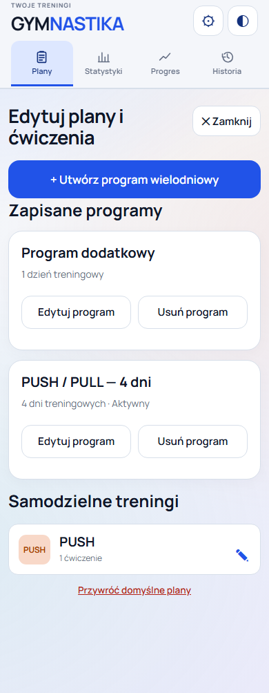 | 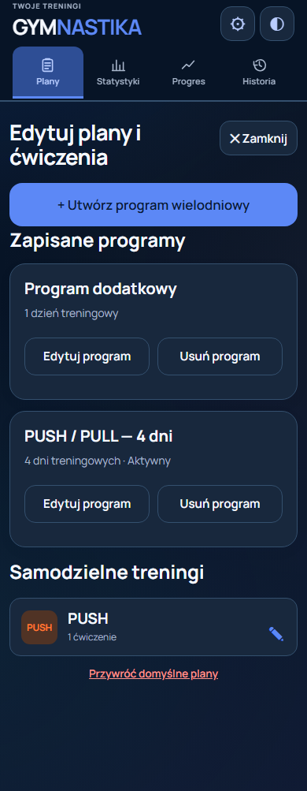 |

## Aktywny trening

| LIGHT | DARK |
|---|---|
| 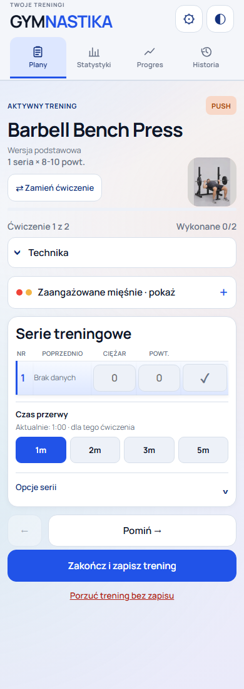 | 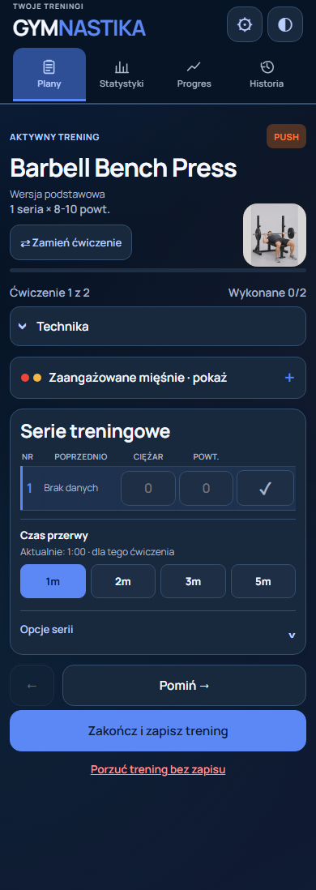 |

## Statystyki

| LIGHT | DARK |
|---|---|
| 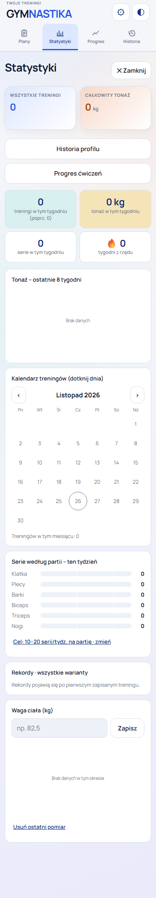 | 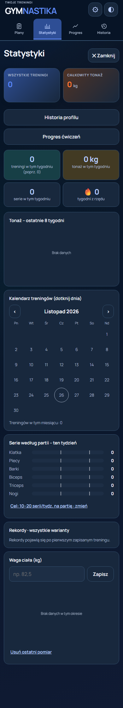 |

## Ustawienia

| LIGHT | DARK |
|---|---|
| 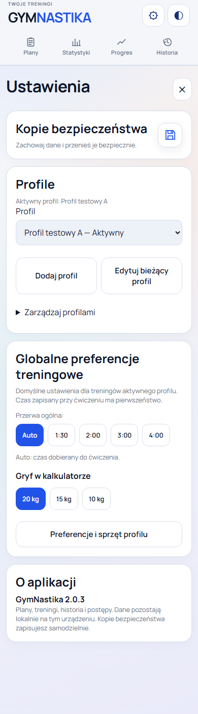 | 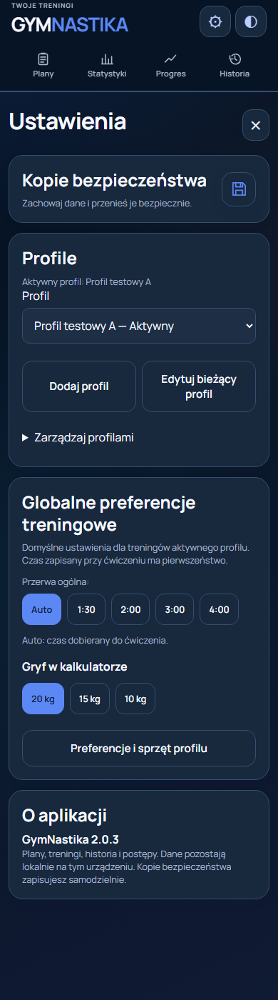 |

## Kopie bezpieczeństwa

| LIGHT | DARK |
|---|---|
| 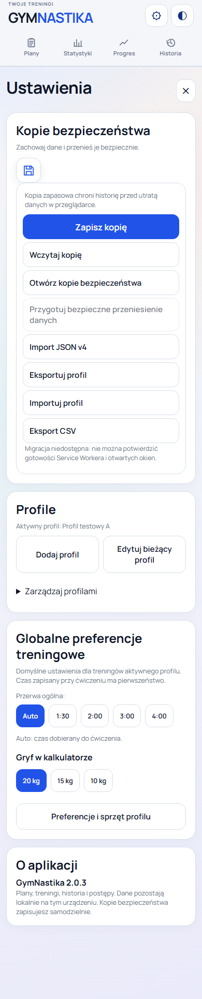 | 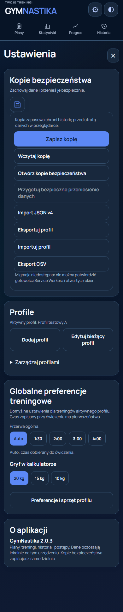 |
